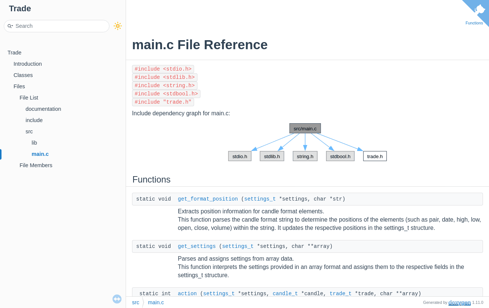

<div align="center">

# Trade

**Un bot de trading en C, entièrement documenté avec Doxygen.**

   

<sub>Projet solo · 2024</sub>

</div>

<br/>

<p align="center"></p>

## Le projet en quelques mots

Un bot qui dialogue avec un moteur de trading par l'entrée et la sortie standard. À chaque bougie (*candle*), il décide d'acheter, de vendre ou de ne rien faire, en tenant compte des frais. Le code est documenté fonction par fonction, et la doc HTML est générée avec Doxygen.

## Ce que ça fait

- Lecture des paramètres du moteur : capital, frais, format des bougies…
- Lecture du flux de bougies (open, high, low, close, volume)
- Décision `buy` / `sell` / `no_moves` à chaque tour
- Documentation Doxygen complète dans [`documentation/`](documentation)

## Lancer le projet

```bash
make
```
